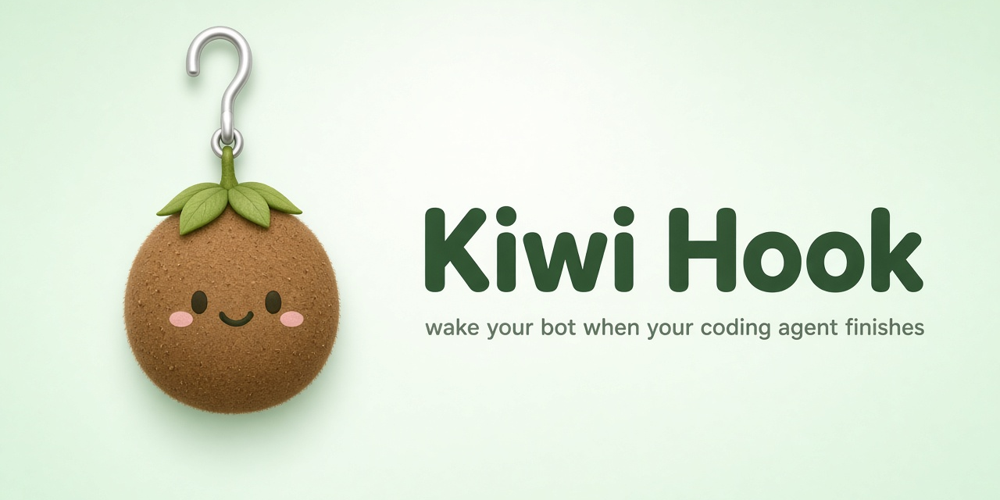
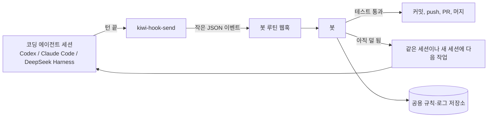

# 키위훅 (Kiwi Hook)

**코딩 에이전트가 한 턴을 끝내면, 봇이 깨어나서 다음 일을 이어 가요.**

터미널을 지켜보며 기다릴 필요가 없어요. Codex, Claude Code 같은 코딩 에이전트가 턴을 끝내면 작은 훅이 웹훅으로 이벤트 하나를 보내요. 봇(저희는 Grok Bot 루틴을 써요)이 깨어나 결과를 확인하고 다음 단계를 해요. 커밋, push, PR, 또는 세션에 다음 작업 지시.

## 좋은 점

- **여러 에이전트에서 써요.** 턴이 끝날 때 명령을 실행할 수 있으면 뭐든 돼요. Codex, Claude Code, DeepSeek Harness는 이 기능이 기본으로 있어요.
- **웹훅을 직접 설치하지 않아도 돼요.** Grok Bot에게 부탁하면 웹훅 트리거가 있는 루틴을 만들고, 에이전트 설정에 훅까지 넣어 줘요.
- **병렬로 돌아가요.** 서로 독립된 작업은 세션을 나눠 돌리고, 끝날 때마다 봇을 깨워요.
- **기록이 한곳에 모여요.** 봇이 공용 규칙·로그 저장소에 남겨서 모든 봇과 세션이 같은 기록을 봐요.
- **테스트가 통과하면 머지까지.** 규칙이 허락하면 봇이 직접 머지해요.

## 동작 방식

보내는 내용은 작아요. 에이전트, 이벤트, 세션 id, 머신, 폴더, 마지막 답의 끝 몇백 자. 코드나 비밀값은 보내지 않아요.

## 빠른 시작 (쉬운 방법)

Grok Bot에게 이렇게 말해 보세요.

> 이 컴퓨터의 Codex(또는 Claude Code)에 키위훅을 설정해 줘. 웹훅 트리거 루틴을 만들고, URL과 키는 비공개로 저장하고, 에이전트의 턴 끝 훅에 연결해 줘. 그리고 테스트 이벤트를 보내 봐.

직접 설정하는 방법과 에이전트별 설정은 [영어 README](README.md)에 있어요.

## 안전 수칙

- 웹훅 URL과 키는 git에 넣지 마세요. `~/.kiwi-hook.env`(chmod 600)에 두세요.
- 보내기가 실패해도 에이전트는 멈추지 않아요. URL이 없으면 아무것도 안 해요.
- 코드가 아니라 요약만 보내요. 최대 600자.
- 봇에게 규칙을 분명히 주세요. push할 저장소, 머지해도 되는 때, 꼭 물어봐야 하는 때.
- 끄려면 `~/.kiwi-hook.env`를 지우면 돼요.

## 라이선스

MIT. [207 Studio](https://207studio.dev)
