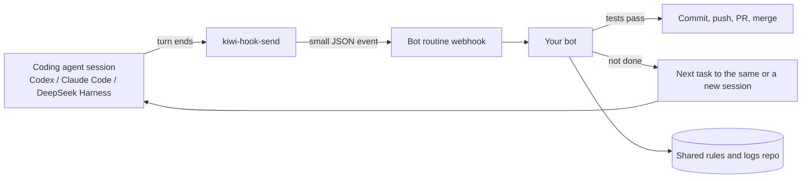

<p align="center"></p>

# Kiwi Hook

**Your coding agent finishes a turn. Your bot wakes up and keeps the work moving.**

No more watching a terminal and waiting. When Codex, Claude Code or another coding agent ends a turn, a tiny hook sends one event to a webhook. Your bot (we use a Grok Bot routine) wakes up, checks the result, and does the next step: commit, push, open a PR, or give the session its next task.

## Why you might like it

- **Works with many agents.** Anything that can run a command when a turn ends can use it. Codex, Claude Code and DeepSeek Harness have this built in.
- **You don't wire the webhook by hand.** Ask your Grok Bot to set it up. It creates a routine with a webhook trigger and adds the hook to your agent's config for you.
- **Parallel by default.** Independent tasks run in separate sessions. Each one wakes the bot when it is done.
- **One shared log.** The bot writes what happened to a shared rules and logs repo, so every bot and every session sees the same history.
- **Merges when green.** If your rules allow it, the bot merges once tests pass.

## How it works



The event is small: agent, event, session id, machine, folder, and the last few hundred characters of the agent's reply. No code, no secrets.

## Quick start (the easy way)

Tell your Grok Bot something like:

> Set up Kiwi Hook for my Codex (or Claude Code) on this machine. Make a routine with a webhook trigger, keep the URL and key private, and connect my agent's turn-end hook to it. Then send a test event.

It will create the routine, save the URL and key in a private file, add the hook, and confirm the routine woke up.

## Quick start (by hand)

1. Make a webhook that wakes your bot. In Grok Bot, this is a routine with a webhook trigger.
2. Save its URL and key on the agent's machine:

   ```sh
   cat > ~/.kiwi-hook.env <<'X'
   KIWI_HOOK_URL=https://YOUR-WEBHOOK-URL
   KIWI_HOOK_KEY=YOUR-KEY
   X
   chmod 600 ~/.kiwi-hook.env
   ```
3. Put `hooks/kiwi-hook-send` on your PATH.
4. Add the hook for your agent (below).
5. Paste [examples/bot-routine-prompt.md](examples/bot-routine-prompt.md) into your routine.

## Per-agent setup

### Codex

Codex runs the `notify` program after each turn and passes a JSON argument. In `~/.codex/config.toml`:

```toml
notify = ["kiwi-hook-send", "codex", "turn-end"]
```

If you already have a `notify` program, keep it: call both from a small wrapper script.

### Claude Code

Claude Code has a `Stop` hook that runs when a session finishes responding. It sends the hook JSON on stdin. In `~/.claude/settings.json`:

```json
{
  "hooks": {
    "Stop": [
      { "hooks": [ { "type": "command", "command": "kiwi-hook-send claude-code turn-end" } ] }
    ],
    "Notification": [
      { "matcher": "permission_prompt",
        "hooks": [ { "type": "command", "command": "kiwi-hook-send claude-code permission-request" } ] }
    ]
  }
}
```

### DeepSeek Harness (dsh)

dsh plugins can listen to session events. Listen for `turn/end` (and `approval/asked` if you want permission pings) and POST the same JSON. A small plugin does it:

```js
export const name = 'kiwi-hook'
export function apply(ctx) {
  ctx.on('session/event', (session, event) => {
    if (event?.type !== 'turn/end') return
    const url = process.env.KIWI_HOOK_URL
    if (!url) return
    fetch(url, {
      method: 'POST',
      headers: { 'content-type': 'application/json', authorization: `Bearer ${process.env.KIWI_HOOK_KEY || ''}` },
      body: JSON.stringify({ agent: 'dsh', event: 'turn-end', session: session?.id, at: new Date().toISOString() }),
    }).catch(() => {})
  })
}
```

### Other agents

If your agent has no turn-end hook, wrap it: run the agent in a script, and call `kiwi-hook-send <agent> turn-end` when it exits. This works well for one-shot runs like `codex exec` or `claude -p`.

## Safety notes

- Keep the webhook URL and key out of git. Use `~/.kiwi-hook.env` with `chmod 600`, or your OS secret store.
- The sender never fails your agent. No URL means it does nothing. Errors are ignored.
- Send summaries, not code. The event carries at most 600 characters of the last reply.
- Give your bot clear rules: which repos it may push to, when it may merge, and when it must ask you.
- Back up your agent config before adding hooks, so you can undo in one step.
- To turn it off, delete `~/.kiwi-hook.env`.

## License

MIT. Made by [207 Studio](https://207studio.dev).
